

[English](../../README.md) · [Español](README_es.md) · [Português](README_pt.md) · [Français](README_fr.md) · [Deutsch](README_de.md) · [Italiano](README_it.md) · [日本語](README_ja.md) · [简体中文](README_zh_cn.md) · **Русский**

# Yagua · Image Processor

### Ваши изображения. Ваш компьютер. Ваш рабочий процесс.

Бесплатные инструменты с открытым исходным кодом для преобразования, сжатия и пакетной обработки изображений на компьютере.

**Официальный сайт (страницы на английском)**

[Главная](https://yagua.bouixdev.workers.dev/en/) · [Скачать](https://yagua.bouixdev.workers.dev/en/downloads/) · [Документация](https://yagua.bouixdev.workers.dev/en/docs/) · [Частые вопросы](https://yagua.bouixdev.workers.dev/en/faq/)

  
  
  
  
  

**[Скачать](https://github.com/GuilleBouix/Yagua-Image-Processor/releases) · [Возможности](#features) · [Установка](#installation)**

[Скриншоты](#screenshots) · [Использование](#usage) · [Требования](#requirements) · [Частые вопросы](#faq) · [Участие в разработке](#contributing)

## Почему Yagua?

Yagua объединяет повседневные операции с изображениями в одном настольном приложении для веб-разработчиков, дизайнеров, фотографов и всех, кто работает с коллекциями изображений. Для обработки файлов не нужны подписка или браузер.

Обработка изображений выполняется на вашем компьютере. Для удаления фона и OCR сначала требуется скачать модели, после чего эти функции могут работать без интернета, если нужные модели сохранены в кеше. Проверка обновлений обращается к GitHub; ссылки на скачивание, пожертвования и карты открываются в браузере.

В текущем исходном коде интерфейс поддерживает **английский, испанский, португальский, французский, немецкий, итальянский, японский, упрощённый китайский и русский**, а также тёмные темы и предварительный просмотр там, где он предусмотрен. В опубликованных пакетах языков может быть меньше: их доступность зависит от установленной версии. Язык интерфейса не добавляет языки распознавания OCR.

## Возможности

В таблице перечислены модули настольного приложения. Доступность функций и элементов управления зависит от установленной версии; читайте примечания к её выпуску.

| Модуль | Возможности | Форматы и результат | Лимит выбора |
| --- | --- | --- | --- |
| Преобразование | Изменение формата и настройка качества, если формат это поддерживает. | Вывод в JPEG, PNG, WebP, AVIF, HEIC, ICO, BMP, TIFF и статический GIF. | 100 изображений |
| Сжатие | Уменьшение размера файла с сохранением исходного формата. | JPEG, PNG, WebP, AVIF, HEIC/HEIF и другие поддерживаемые растровые форматы. | 100 изображений |
| Размер / Обрезка / Холст | Задание размеров, обрезка, расширение холста и использование готовых размеров. | Распространённые растровые изображения, включая JPEG, PNG и WebP. | 100 изображений |
| Удаление фона | Локальное удаление фона с помощью ИИ. | Вывод в PNG, WebP или TIFF с прозрачностью. | 10 изображений |
| Палитра цветов | Извлечение цветов, копирование значений HEX/RGB/HSL и экспорт палитры. | Одно поддерживаемое изображение → цвета и палитра в PNG. | 1 изображение |
| Водяной знак | Наложение логотипа с настройкой положения, размера, непрозрачности и отступа. | Поддерживаемые исходные изображения; для логотипа рекомендуется прозрачный PNG. | 100 изображений + 1 логотип |
| Переименование | Предпросмотр имён с нумерацией, датами и изменением регистра. | Изменяет имена файлов в их текущей папке. | 100 файлов |
| OCR | Извлечение испанского и/или английского текста с EasyOCR, копирование или экспорт в TXT. | Поддерживаемые растровые изображения → текст. | 10 изображений |
| Метаданные EXIF | Просмотр, экспорт, редактирование полей и пакетное удаление метаданных. | Редактирование JPEG/TIFF; экспорт метаданных в TXT/JSON. | 1 изображение для редактирования; 100 для очистки |
| LQIP / Base64 | Создание миниатюр низкого качества для предварительной загрузки или кодирование изображений для веба. | Base64, data URI, HTML и CSS; экспорт в TXT/JSON. | 1 изображение |

Поддержка форматов зависит от модуля, установленных кодеков и платформы. Наличие формата в списке не гарантирует, что каждый модуль сможет его читать или записывать. См. [требования](#requirements).

## Скриншоты

Скриншоты Yagua с английским интерфейсом. Нажмите на миниатюру, чтобы открыть изображение в полном размере. Расположение и элементы управления могут различаться между версиями.

<table>
  <tr>
    <td align="center" width="50%"><a href="../../assets/screenshots/home.webp">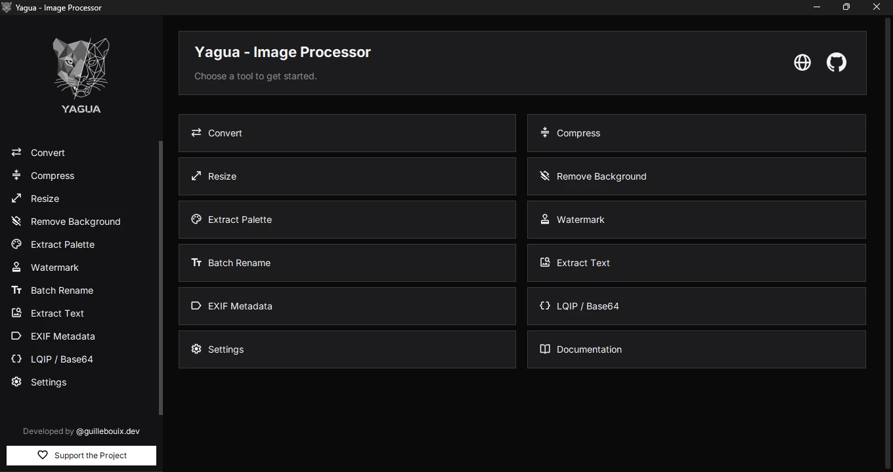</a></td>
    <td align="center" width="50%"><a href="../../assets/screenshots/convert.webp">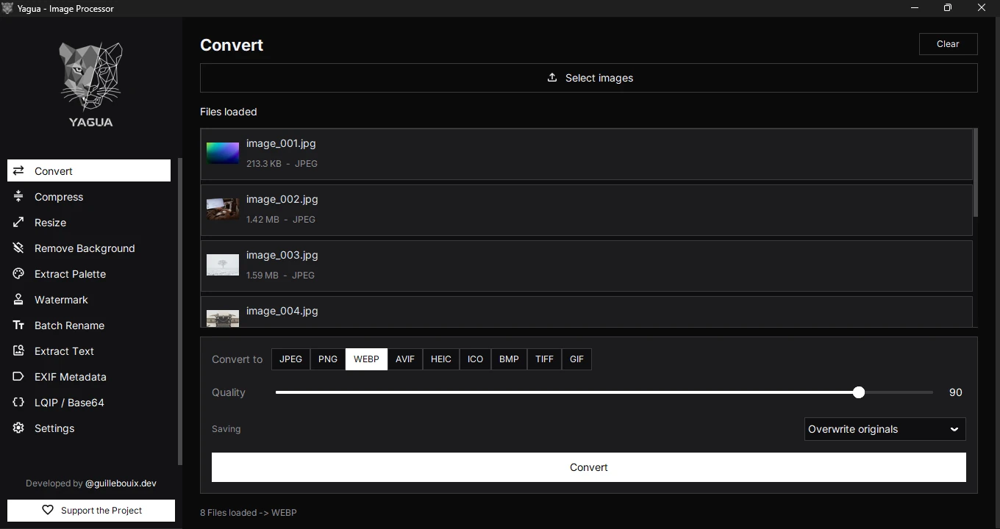</a></td>
  </tr>
  <tr>
    <td align="center" width="50%"><a href="../../assets/screenshots/compress.webp">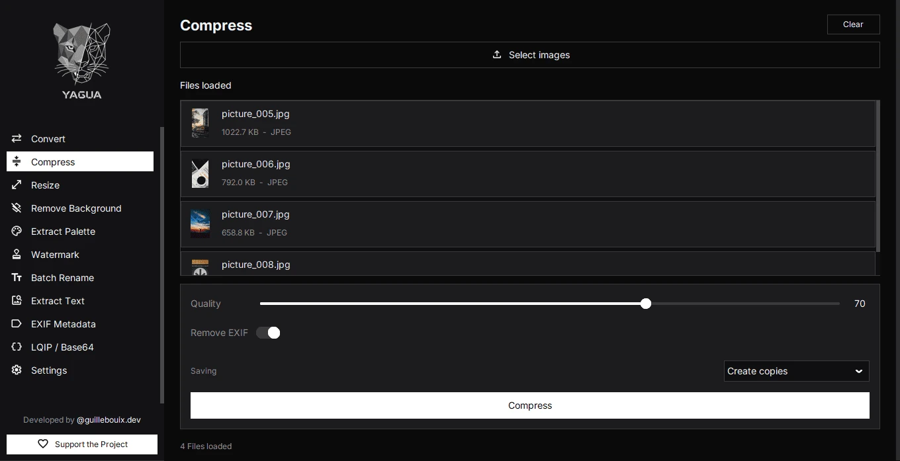</a></td>
    <td align="center" width="50%"><a href="../../assets/screenshots/resize.webp">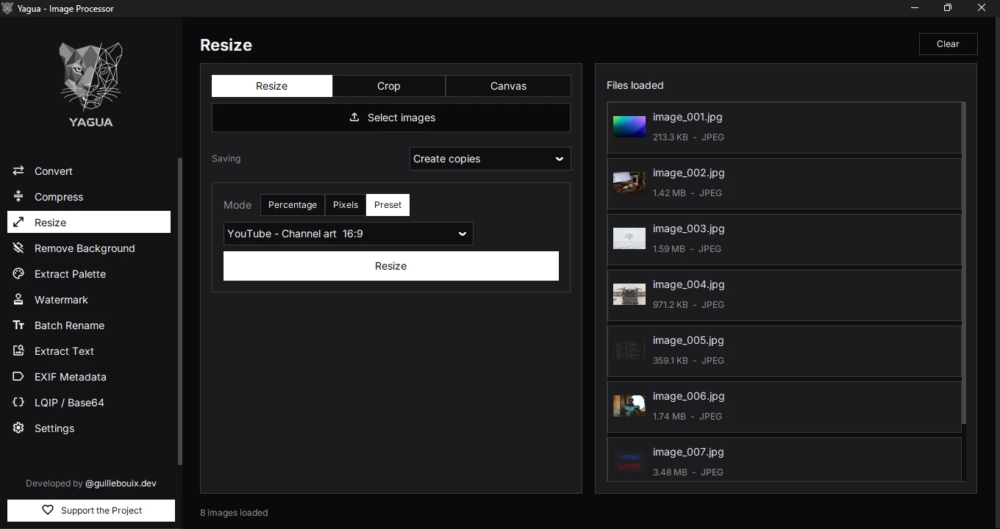</a></td>
  </tr>
  <tr>
    <td align="center" width="50%"><a href="../../assets/screenshots/remove-background.webp">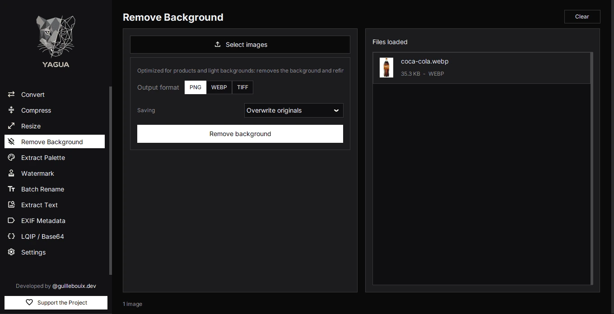</a></td>
    <td align="center" width="50%"><a href="../../assets/screenshots/palette.webp">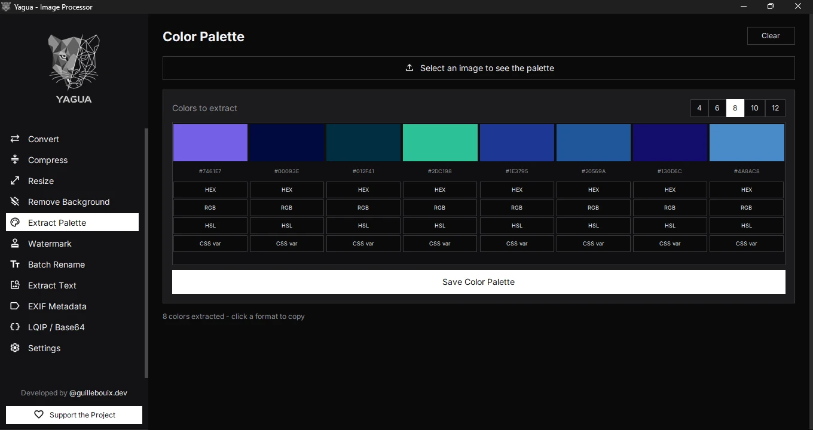</a></td>
  </tr>
  <tr>
    <td align="center" width="50%"><a href="../../assets/screenshots/watermark.webp">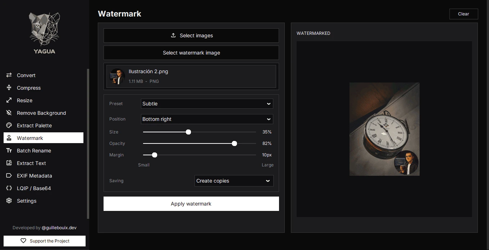</a></td>
    <td align="center" width="50%"><a href="../../assets/screenshots/rename.webp">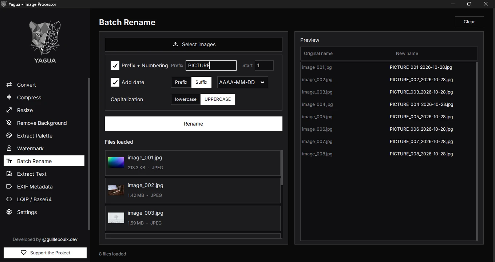</a></td>
  </tr>
  <tr>
    <td align="center" width="50%"><a href="../../assets/screenshots/ocr.webp">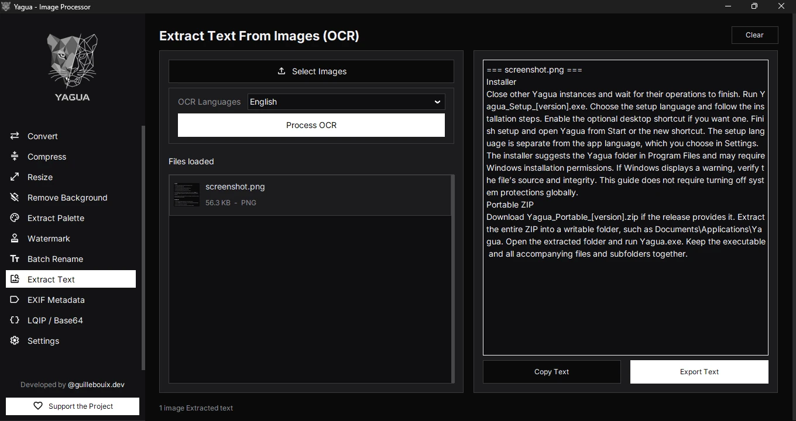</a></td>
    <td align="center" width="50%"><a href="../../assets/screenshots/metadata.webp">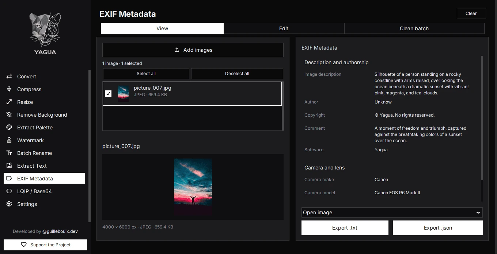</a></td>
  </tr>
  <tr>
    <td align="center" width="50%"><a href="../../assets/screenshots/lqip-base64.webp">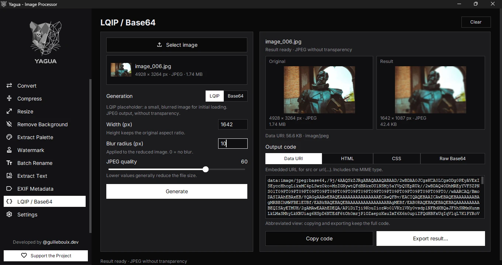</a></td>
    <td align="center" width="50%"><a href="../../assets/screenshots/settings.webp">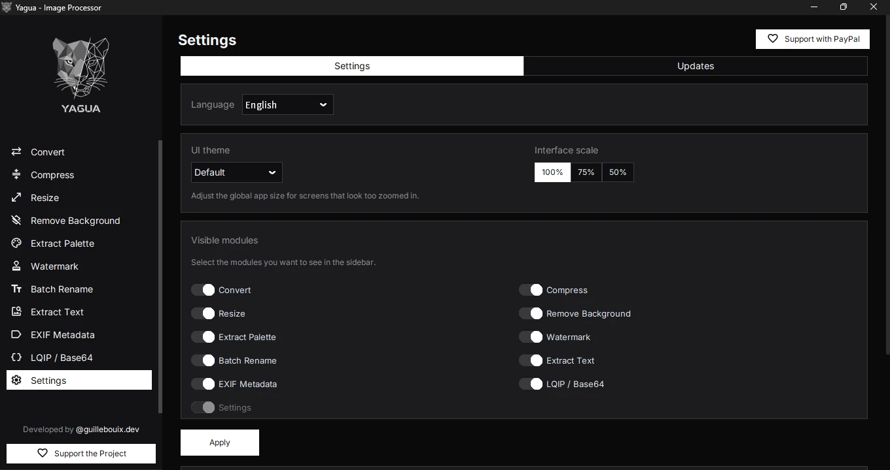</a></td>
  </tr>
</table>

## Установка

### Выбор выпуска

Откройте **[GitHub Releases](https://github.com/GuilleBouix/Yagua-Image-Processor/releases)** и выберите свою операционную систему. Значок **stable** ведёт на последнюю стабильную версию на GitHub; более новые сборки с отметкой **Pre-release**, включая сборки `rc`, являются тестовыми. Версии для Windows и Linux могут различаться.

Версия исходного кода определена в [`app/version.py`](../../app/version.py). Это не означает, что соответствующий установщик уже опубликован. Читайте примечания к каждому выпуску и скачивайте приложенные к нему файлы.

| Платформа | Пакет | Действия |
| --- | --- | --- |
| Windows | `Yagua_Setup_<version>.exe` | Запустите установщик, затем откройте Yagua из меню «Пуск» или через ярлык на рабочем столе. |
| Windows, портативная версия | `Yagua_Portable_<version>.zip`, если предоставлен | Полностью распакуйте ZIP в папку с правом записи и запустите `Yagua.exe` внутри неё. Храните сопутствующие файлы вместе. |
| Linux x86_64 | `Yagua-<version>-x86_64.AppImage`, если предоставлен | Сделайте скачанный файл исполняемым и запустите его, как показано ниже. |
| macOS | Экспериментальный запуск/сборка из исходников | Стабильный пакет для macOS не гарантируется. См. существующий [скрипт сборки](../../scripts/build_macos_app.sh). |

В Linux замените имя файла в примере на имя скачанного файла:

~~~bash
chmod +x "Yagua-<version>-x86_64.AppImage"
./"Yagua-<version>-x86_64.AppImage"
~~~

### Запуск из исходного кода

Используйте **Python 3.13**, применяемый в CI проекта, и Git. Установка зависимостей может занимать много места, поскольку включает библиотеки OCR и ИИ. В Linux также требуются Tk и системные библиотеки из раздела [требований](#requirements).

**Windows · PowerShell**

~~~powershell
git clone https://github.com/GuilleBouix/Yagua-Image-Processor.git
cd Yagua-Image-Processor
py -3.13 -m venv .venv
.\.venv\Scripts\python.exe -m pip install --upgrade pip
.\.venv\Scripts\python.exe -m pip install -r requirements.txt
.\.venv\Scripts\python.exe main.py
~~~

**Linux · Bash**

~~~bash
git clone https://github.com/GuilleBouix/Yagua-Image-Processor.git
cd Yagua-Image-Processor
python3.13 -m venv .venv
source .venv/bin/activate
python -m pip install --upgrade pip
python -m pip install -r requirements.txt
python main.py
~~~

Команды используют зависимости с зафиксированными в репозитории версиями. Проверки CI для Windows/Linux не подтверждают совместимость с другими версиями Python или macOS.

## Использование

1. Откройте Yagua и выберите модуль на боковой панели.
2. Загрузите изображения и задайте доступные параметры обработки.
3. Проверьте предварительный просмотр, если он предусмотрен модулем.
4. Обработайте изображения и при запросе выберите папку для результата; проверьте сообщение о завершении на наличие ошибок.

**LQIP / Base64:** Выберите одно изображение, задайте режим и параметры, создайте результат, сравните и скопируйте или экспортируйте data URI, HTML, CSS либо строку Base64. Загрузка другого изображения возвращает режим LQIP, ширину 20 px, размытие 2 и качество 40/85; отмена выбора файла сохраняет текущее состояние. Оба режима выводят JPEG без прозрачности.

**Исходные файлы:** Переименование меняет имена на месте. Редактирование EXIF перезаписывает выбранное изображение после подтверждения. Для этих операций используйте копии. Пакетная очистка EXIF сохраняет результат в выбранную выходную папку. Другие операции экспорта используют диалог сохранения или выбора выходной папки своего модуля.

### Примеры использования

- **Изображения для веба:** Преобразуйте до 100 фотографий в WebP, выберите качество и при необходимости измените размер. Отдельно создайте LQIP-миниатюры для отображения во время загрузки изображений на сайте.
- **Фотографии товаров:** Загрузите до 10 изображений в модуль удаления фона и экспортируйте их в PNG или WebP для сохранения прозрачности. При необходимости добавьте прозрачный логотип PNG с помощью водяного знака.
- **Извлечение текста:** Загрузите до 10 чётких изображений в OCR, выберите испанский, английский или оба языка, затем скопируйте результат или экспортируйте TXT. Язык интерфейса не добавляет языки распознавания OCR. Проверьте текст на ошибки распознавания.

## Требования и ограничения

### Оборудование

Для полной функциональности, включая **OCR и удаление фона**:

| Компонент | Предварительный минимум | Рекомендуется |
| --- | --- | --- |
| Процессор | Относительно современный Intel/AMD x86-64 с **4 ядрами** | Современный процессор с **6–8 ядрами** |
| Оперативная память компьютера | **8 GB**, при небольшом числе других открытых приложений | **16 GB**; **32 GB** для очень больших изображений и многозадачности |
| Накопитель | **4 GB свободно**, дополнительно место для оригиналов и результатов | **SSD с 10 GB свободного места или больше**, помимо места для изображений |
| Графика | Встроенной графики достаточно; дискретный GPU не требуется | Встроенной графики достаточно |
| Интернет | Для первоначального скачивания моделей и проверки обновлений | Работа без интернета после скачивания необходимых моделей |

**Это практические оценки для полного приложения, а не проверенные минимальные требования. Испытания на маломощном ПК ещё не проведены.** Система с 4 GB оперативной памяти не рекомендуется для полноценного использования OCR и удаления фона. Потребление ресурсов зависит от разрешения изображений, размера пакета и моделей; при нехватке ресурсов уменьшайте число изображений в пакете.

Проверенный пакет обрабатывает изображения на **CPU**; NVIDIA или другой дискретный GPU не нужен. Отдавайте приоритет процессору, памяти и SSD. Удаление фона использует провайдер выполнения на CPU в ONNX Runtime; см. [официальную документацию ONNX Runtime](https://onnxruntime.ai/docs/api/python/api_summary.html).

### Операционные системы

| Система | Базовая среда и проверка |
| --- | --- |
| Windows | **Windows 10/11, 64 бита**; предпочтительно Windows 11. ONNX Runtime указывает Windows 10 как минимально поддерживаемую версию Windows. Проверка итогового установщика и портативного пакета на чистых ПК с Windows 10/11 ещё не проведена. |
| Linux | **Ubuntu 22.04 x86-64** — базовая среда, проверяемая в CI. Для других дистрибутивов, версий и окружений рабочего стола необходима проверка итогового AppImage. |
| macOS | Экспериментальная поддержка; наличие проверенного нативного пакета не заявляется. |

Текущие пакеты Windows и Linux рассчитаны на **x86-64**; проверенной нативной версии для ARM нет. CI использует Windows Server и Ubuntu 22.04/Xvfb; эти проверки не подтверждают работу на всех настольных системах. См. [требования ONNX Runtime к платформам](https://onnxruntime.ai/docs/build/inferencing.html).

Измеренное потребление ресурсов и первая загрузка модели

Аудит пакетов зафиксировал следующие приблизительные значения для сборок CI, проверенных 15 октября 2026 года:

| Измерение | Windows | Linux |
| --- | --- | --- |
| Наблюдавшийся пик памяти процесса при нескольких загруженных моделях | **3.0 GB** | **2.6 GB** |
| Приложение + все модели и кеши, измеренные в тесте | **1.10 GB** | **1.53 GB** |
| Первая загрузка модели удаления фона (ISNet) | **53 секунды** | **39 секунд** |

**Это наблюдения, а не гарантированные максимумы или время обработки.** В тесте памяти несколько моделей оставались загруженными; большие фотографии могут потреблять больше памяти. Показатели на диске охватывают измеренные пакет, модели и кеши, но не оригиналы, результаты, временное место для распаковки или среду разработки из исходников. Время загрузки модели зависит от компьютера; затем сеанс используется повторно. Это не время скачивания модели и не время обработки одного изображения.

### Среда выполнения и обработка

- **Из исходников:** Python 3.13, Tk и библиотеки из [`requirements.txt`](../../requirements.txt). Готовые пакеты не требуют отдельной установки Python.
- **Лимиты пакетов:** Таблица возможностей указывает текущие ограничения интерфейса: одно изображение для палитры, LQIP / Base64 или редактирования EXIF, 10 для OCR/удаления фона и 100 для остальных перечисленных пакетных операций.
- **Кодеки:** Для HEIC/HEIF используется `pillow-heif`, включённый в зависимости исходного кода. AVIF и другие форматы зависят от кодеков Pillow и платформы. JPEG не поддерживает прозрачность; используйте PNG или WebP, если нужен альфа-канал. Сжатие PNG может сократить палитру до 256 цветов, поэтому проверяйте результат.
- **Модели ИИ:** Скачивание возможно при первом использовании или при выборе новой модели/языка распознавания, для которых нужна другая модель. Для работы без интернета модели должны быть уже сохранены. Проверенный пакет выполняет OCR и удаление фона на CPU.

### Системные библиотеки Linux

Для запуска AppImage через монтирование нужен **FUSE 2** (`libfuse2` в совместимых дистрибутивах). Если FUSE недоступен, можно использовать распаковку; см. [официальную инструкцию AppImage](https://docs.appimage.org/user-guide/troubleshooting/fuse.html). Замените имя файла в примере на скачанное:

~~~bash
./"Yagua-<version>-x86_64.AppImage" --appimage-extract-and-run
~~~

Распаковка требует дополнительного временного места на диске и может замедлить запуск. Для запуска из исходников Linux CI устанавливает Tk и следующие библиотеки в Ubuntu 22.04:

~~~bash
sudo apt-get install python3-tk libgl1 libglib2.0-0 libsm6 libxext6 libxrender1 libgtk-3-0 libgomp1
~~~

Названия пакетов зависят от дистрибутива. Убедитесь, что Tk доступен для используемого интерпретатора Python 3.13; стандартный пакет Tk дистрибутива может не подходить для отдельно установленного Python.

## Частые вопросы

### Yagua загружает мои изображения в интернет?

Обработка выполняется локально; модули не отправляют изображения в сервис обработки. Для скачивания моделей и проверки обновлений на GitHub нужно соединение с сетью. Внешние ссылки открываются в браузере; при открытии ссылки на карту EXIF выбранные GPS-координаты отправляются в Google Maps.

### Почему первая операция ИИ медленнее?

OCR и удаление фона инициализируют свои движки и могут скачивать модели. Дождитесь завершения этого этапа. Последующие запуски могут использовать кешированные модели; большие изображения и пакеты всё равно требуют больше ресурсов.

### Почему формат недоступен или изображение отклоняется?

Поддерживаемые входные форматы зависят от модуля и доступности кодеков. Попробуйте копию в PNG или JPEG и проверьте `yagua.log`. Если нужна прозрачность, экспортируйте в PNG или WebP.

### Почему сжатие уменьшает не каждое изображение?

Уже оптимизированное изображение может не стать меньше. Если удаление EXIF отключено, Yagua копирует оригинал в выходную папку, когда сжатие дало бы файл такого же или большего размера. Если удаление EXIF включено, обработанное изображение сохраняется даже при большем размере, чтобы этот запасной вариант не восстановил исходные EXIF. Для отдельной очистки EXIF используйте модуль метаданных.

### Как работают обновления?

Yagua может уведомлять при запуске и позволяет проверить обновления в разделе **Настройки → Обновления**. Приложение открывает ссылку для скачивания, но не устанавливает обновления автоматически. Пакеты RC.4/RC.5 ищут только более новые стабильные выпуски с соответствующим префиксом платформы (`win-v` или `linux-v`); предварительные выпуски и черновики исключаются, поэтому новые сборки RC не обнаруживаются. Скачивайте тестовые сборки вручную из [GitHub Releases](https://github.com/GuilleBouix/Yagua-Image-Processor/releases). Эти пакеты также могут сообщать «Нет доступных обновлений» после сбоя соединения; при сомнениях проверьте Releases напрямую, включая более старые выпуски без префикса платформы.

### Как сообщить о проблеме?

Создайте [отчёт об ошибке](https://github.com/GuilleBouix/Yagua-Image-Processor/issues/new?template=bug_report.md), указав версию Yagua, ОС, модуль, шаги воспроизведения и соответствующие логи. Файл `yagua.log` находится здесь:

- Windows: `%APPDATA%\Yagua\yagua.log`
- Linux: `~/.config/Yagua/yagua.log`
- macOS: `~/Library/Application Support/Yagua/yagua.log`

Логи могут содержать пути и имена файлов; проверьте их перед отправкой.

## Разработка и участие

Yagua использует **CustomTkinter** для интерфейса, **Pillow / pillow-heif** для изображений, **rembg / ONNX Runtime** для удаления фона, **EasyOCR / PyTorch** для OCR и **piexif** для EXIF. Точные версии указаны в [`requirements.txt`](../../requirements.txt).

После установки из исходников установите инструменты разработки и выполните проверки CI. В Windows вызывайте исполняемые файлы виртуального окружения напрямую:

~~~powershell
.\.venv\Scripts\python.exe -m pip install -r requirements-dev.txt
.\.venv\Scripts\python.exe -m ruff check app tests scripts
.\.venv\Scripts\python.exe -m pyright --skipunannotated --pythonpath .\.venv\Scripts\python.exe app
.\.venv\Scripts\python.exe -m pytest -q
~~~

В Linux с активированным виртуальным окружением:

~~~bash
python -m pip install -r requirements-dev.txt
python -m ruff check app tests scripts
python -m pyright --skipunannotated --pythonpath "$(command -v python)" app
python -m pytest -q
~~~

Тестам интерфейса нужен дисплей. В Linux без графической среды установите `xvfb` и используйте `xvfb-run -a python -m pytest -q`, как в CI.

Историю проекта см. в [`CHANGELOG.md`](../../CHANGELOG.md). Некоторые скриншоты могут отставать от кода. Сообщайте об ошибках, предлагайте функции через [Issues](https://github.com/GuilleBouix/Yagua-Image-Processor/issues) или отправляйте небольшие целевые pull request с соответствующими проверками. При изменении описанного поведения обновляйте все девять языковых версий README.

## Поддержать проект

Если Yagua вам полезен, звезда на GitHub поможет другим найти проект. Также можно помочь сообщениями об ошибках, переводами или участием в разработке.

**[Уже попробовали Yagua? Оставьте оценку (на английском)](https://yagua.bouixdev.workers.dev/en/project/#project-rating)**

**[Поддержать через GitHub Sponsors](https://github.com/sponsors/GuilleBouix) · [Поддержать через PayPal](https://www.paypal.com/paypalme/guillebouix)**

  

## Лицензия

Yagua распространяется под **[лицензией MIT](../../LICENSE)**. Сторонние библиотеки и модели сохраняют свои лицензии.
