

[English](../../README.md) · [Español](README_es.md) · [Português](README_pt.md) · [Français](README_fr.md) · [Deutsch](README_de.md) · [Italiano](README_it.md) · [日本語](README_ja.md) · **简体中文** · [Русский](README_ru.md)

# Yagua · Image Processor

### 你的图像。你的电脑。你的工作方式。

免费、开源的桌面工具，用于批量转换、压缩和处理图像。

  
  
  
  
  

**[下载](https://github.com/GuilleBouix/Yagua-Image-Processor/releases) · [功能](#features) · [安装](#installation)**

[截图](#screenshots) · [使用方法](#usage) · [系统要求](#requirements) · [常见问题](#faq) · [参与贡献](#contributing)

## 为什么选择 Yagua？

Yagua 将日常图像处理任务整合到一个桌面应用中，适合网页开发者、设计师、摄影师以及需要处理图像集合的用户。处理文件无需订阅，也无需使用浏览器。

图像处理在你的电脑上完成。背景移除和 OCR 需要首次下载模型，所需模型缓存后即可离线使用。检查更新会连接 GitHub；下载、捐赠和地图链接会在浏览器中打开。

当前源代码的界面支持**英语、西班牙语、葡萄牙语、法语、德语、意大利语、日语、简体中文和俄语**，提供深色主题，并在适用的模块中提供预览。发行包可能包含较少的语言，具体取决于安装的版本。更改界面语言不会增加 OCR 的识别语言。

## 功能

下表列出了桌面应用的各个模块。功能和控件是否可用取决于安装的版本，请查阅对应的发行说明。

| 模块 | 功能 | 格式与输出 | 选择上限 |
| --- | --- | --- | --- |
| 格式转换 | 更改图像格式，并在格式支持时调整质量。 | 输出 JPEG、PNG、WebP、AVIF、HEIC、ICO、BMP、TIFF 和静态 GIF。 | 100 张图像 |
| 压缩 | 保持原始格式，减小文件大小。 | JPEG、PNG、WebP、AVIF、HEIC/HEIF 及其他受支持的位图格式。 | 100 张图像 |
| 调整大小 / 裁剪 / 画布 | 设置尺寸、裁剪、扩展画布，或使用预设尺寸。 | JPEG、PNG、WebP 等常见位图图像。 | 100 张图像 |
| 背景移除 | 使用 AI 在本地移除背景。 | 输出带透明通道的 PNG、WebP 或 TIFF。 | 10 张图像 |
| 调色板 | 提取颜色、复制 HEX/RGB/HSL 值并导出调色板。 | 一张受支持的图像 → 颜色和 PNG 调色板。 | 1 张图像 |
| 水印 | 添加图像标志，并调整位置、大小、不透明度和边距。 | 受支持的底图；标志建议使用透明 PNG。 | 100 张图像 + 1 个标志 |
| 重命名 | 预览编号、日期和大小写变更后的文件名。 | 在文件当前所在的文件夹中修改名称。 | 100 个文件 |
| OCR | 使用 EasyOCR 提取西班牙语和／或英语文本，复制结果或导出为 TXT。 | 受支持的位图图像 → 文本。 | 10 张图像 |
| EXIF 元数据 | 查看、导出、编辑字段，或批量移除元数据。 | 编辑 JPEG/TIFF；导出 TXT/JSON 元数据。 | 编辑 1 张；清理 100 张 |
| LQIP / Base64 | 生成低质量占位图，或为网页编码图像。 | Base64、data URI、HTML 和 CSS；导出 TXT/JSON。 | 1 张图像 |

格式支持取决于模块、已安装的编解码器和平台。此处列出的格式不代表所有模块都能读取或写入该格式。请参阅[系统要求](#requirements)。

## 截图

以上为英文界面的 Yagua 截图。点击任意缩略图可查看原图。布局和控件可能因版本而异。

<table>
  <tr>
    <td align="center" width="50%"><a href="../../assets/screenshots/home.png">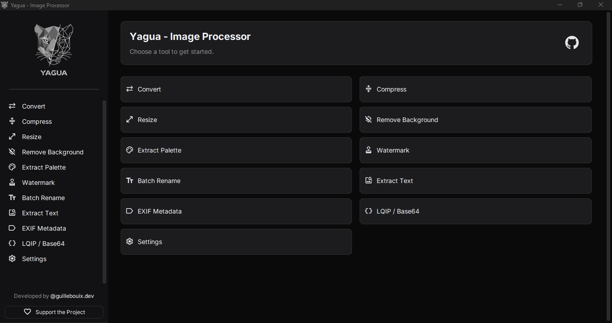</a></td>
    <td align="center" width="50%"><a href="../../assets/screenshots/convert.png">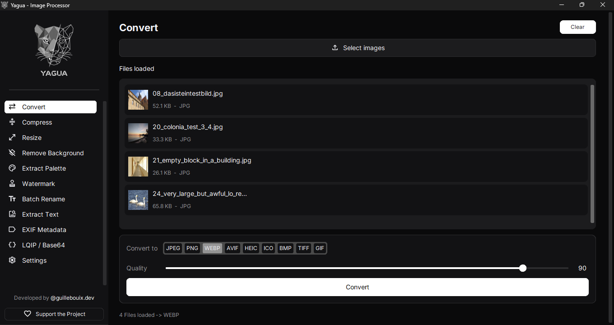</a></td>
  </tr>
  <tr>
    <td align="center" width="50%"><a href="../../assets/screenshots/compress.png">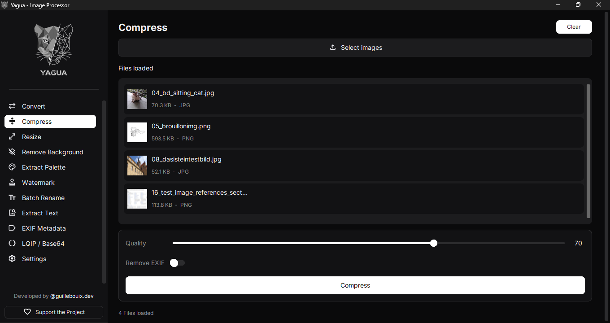</a></td>
    <td align="center" width="50%"><a href="../../assets/screenshots/resize.png">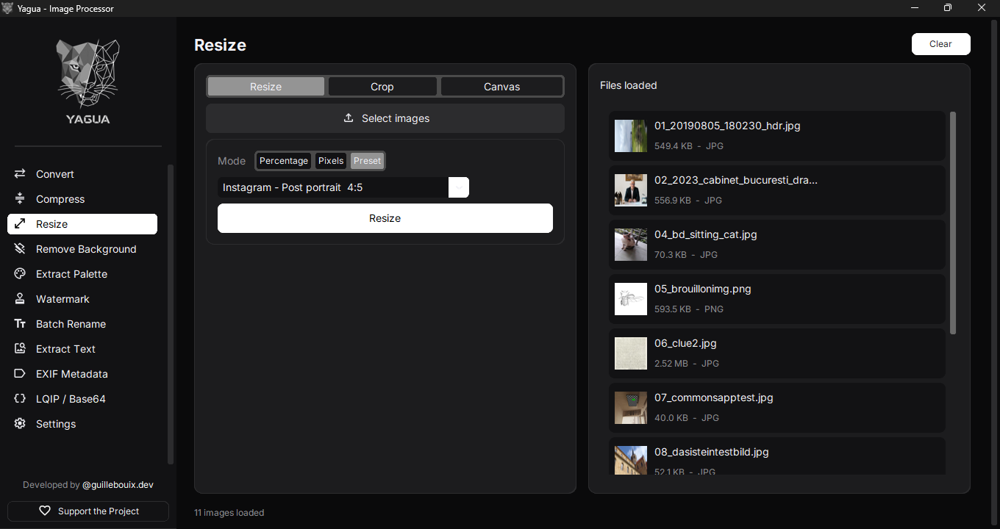</a></td>
  </tr>
  <tr>
    <td align="center" width="50%"><a href="../../assets/screenshots/remove-background.png">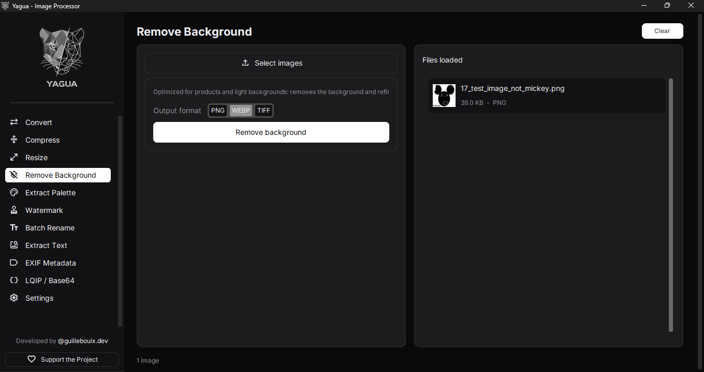</a></td>
    <td align="center" width="50%"><a href="../../assets/screenshots/palette.png">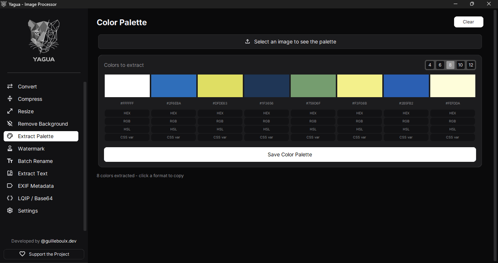</a></td>
  </tr>
  <tr>
    <td align="center" width="50%"><a href="../../assets/screenshots/watermark.png">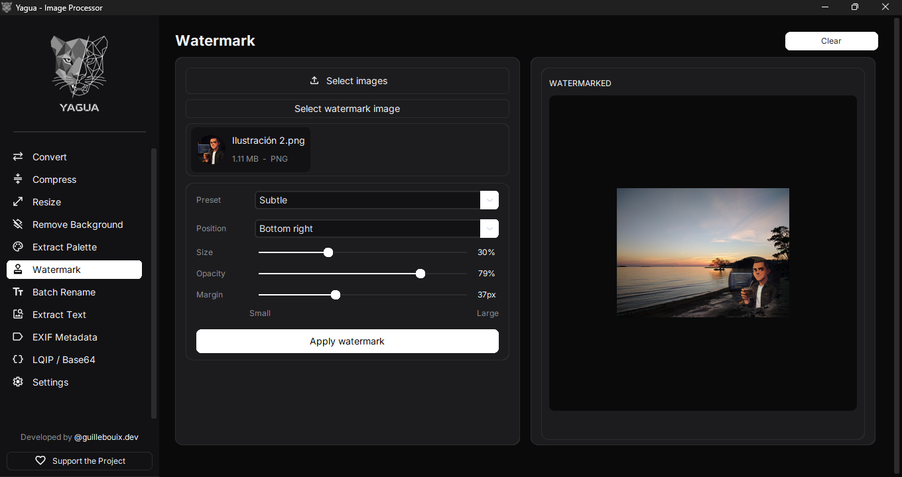</a></td>
    <td align="center" width="50%"><a href="../../assets/screenshots/rename.png">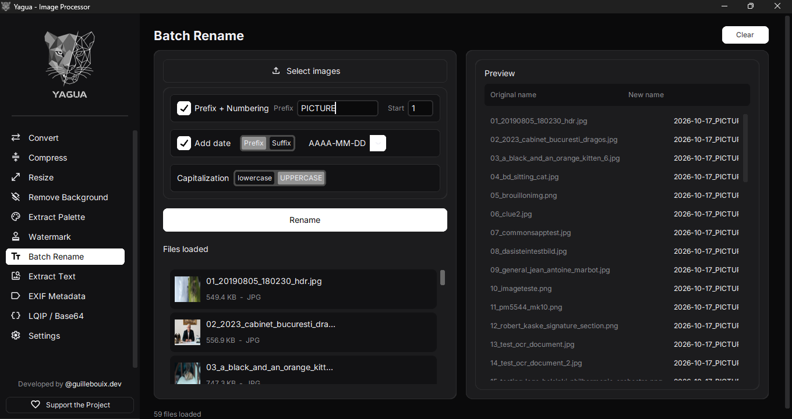</a></td>
  </tr>
  <tr>
    <td align="center" width="50%"><a href="../../assets/screenshots/ocr.png">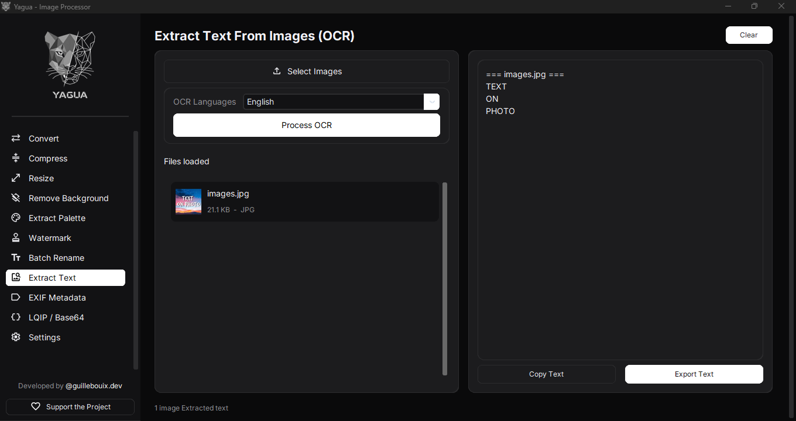</a></td>
    <td align="center" width="50%"><a href="../../assets/screenshots/metadata.png">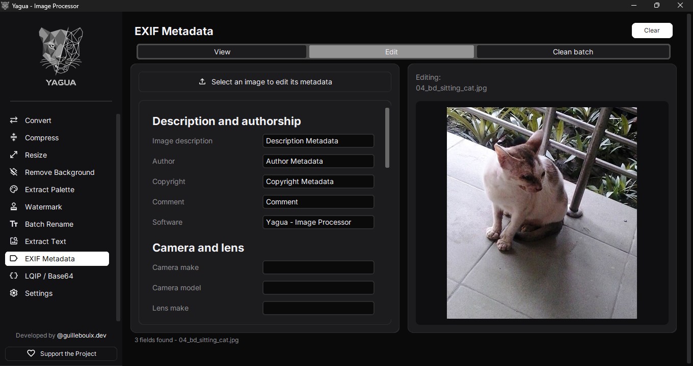</a></td>
  </tr>
  <tr>
    <td align="center" width="50%"><a href="../../assets/screenshots/lqip-base64.png">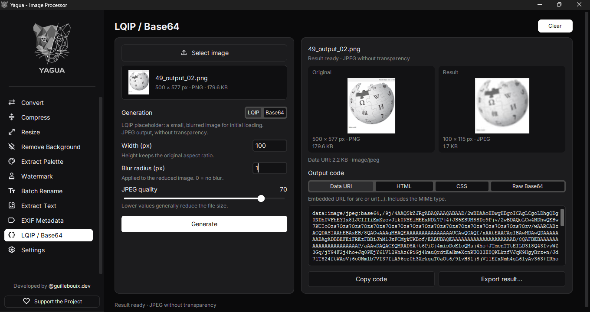</a></td>
    <td align="center" width="50%"><a href="../../assets/screenshots/settings.png">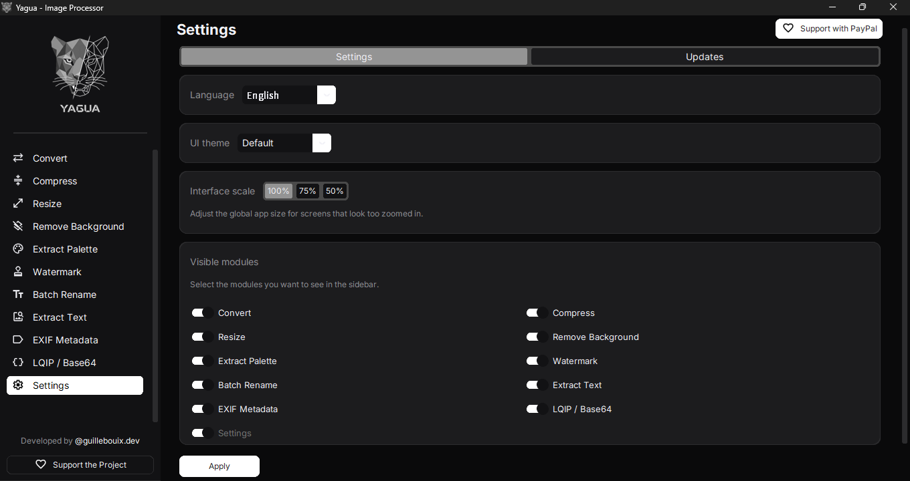</a></td>
  </tr>
</table>

## 安装

### 选择发行版

打开 **[GitHub Releases](https://github.com/GuilleBouix/Yagua-Image-Processor/releases)**，选择你的操作系统。**stable** 徽章链接到 GitHub 上的最新稳定版；标记为 **Pre-release** 的较新构建（包括 `rc` 构建）属于测试版。Windows 和 Linux 的发行版本可能不同。

源代码版本定义在 [`app/version.py`](../../app/version.py) 中，这不代表对应的安装包已经发布。请阅读每个发行版的说明，并下载附在该发行版中的文件。

| 平台 | 安装包 | 步骤 |
| --- | --- | --- |
| Windows | `Yagua_Setup_<version>.exe` | 运行安装程序，然后从开始菜单或桌面快捷方式打开 Yagua。 |
| Windows 便携版 | `Yagua_Portable_<version>.zip`（如提供） | 将整个 ZIP 解压到可写入的文件夹，运行其中的 `Yagua.exe`。请将附带文件保存在一起。 |
| Linux x86_64 | `Yagua-<version>-x86_64.AppImage`（如提供） | 为下载的文件添加执行权限，然后按以下方式运行。 |
| macOS | 实验性源代码运行／构建支持 | 不保证提供稳定的 macOS 安装包。请参阅现有的[构建脚本](../../scripts/build_macos_app.sh)。 |

在 Linux 上，将示例文件名替换为下载的实际文件名：

~~~bash
chmod +x "Yagua-<version>-x86_64.AppImage"
./"Yagua-<version>-x86_64.AppImage"
~~~

### 从源代码运行

请使用项目 CI 所用的 **Python 3.13** 和 Git。依赖项包括 OCR 和 AI 库，安装体积可能较大。Linux 还需要 Tk 和[系统要求](#requirements)中列出的系统库。

**Windows · PowerShell**

~~~powershell
git clone https://github.com/GuilleBouix/Yagua-Image-Processor.git
cd Yagua-Image-Processor
py -3.13 -m venv .venv
.\.venv\Scripts\python.exe -m pip install --upgrade pip
.\.venv\Scripts\python.exe -m pip install -r requirements.txt
.\.venv\Scripts\python.exe main.py
~~~

**Linux · Bash**

~~~bash
git clone https://github.com/GuilleBouix/Yagua-Image-Processor.git
cd Yagua-Image-Processor
python3.13 -m venv .venv
source .venv/bin/activate
python -m pip install --upgrade pip
python -m pip install -r requirements.txt
python main.py
~~~

这些命令使用仓库中固定版本的依赖项。Windows/Linux CI 检查并不能证明与其他 Python 版本或 macOS 的兼容性。

## 使用方法

1. 打开 Yagua，从侧边栏选择一个模块。
2. 加载图像并选择可用的处理选项。
3. 如果模块提供预览，请检查预览结果。
4. 处理图像，并在提示时选择输出文件夹；检查完成消息中是否有错误。

**LQIP / Base64：** 选择一张图像，设置模式和参数，生成并比较结果，然后复制或导出 data URI、HTML、CSS 或原始 Base64。加载另一张图像会重置为 LQIP 模式、宽度 20 px、模糊度 2、质量 40/85；取消文件选择会保留当前状态。两种模式均输出不带透明通道的 JPEG。

**原始文件：** 重命名会直接修改原文件名。EXIF 编辑会在确认后覆盖所选图像。执行这些操作时请使用副本。批量 EXIF 清理会写入所选输出文件夹。其他导出操作遵循各模块的保存或输出文件夹选择流程。

### 实用示例

- **准备网页图像：** 将最多 100 张照片转换为 WebP，选择质量，按需调整尺寸。为网站加载预览单独生成 LQIP 占位图。
- **准备商品照片：** 在背景移除模块中加载最多 10 张图像，导出为 PNG 或 WebP 以保留透明通道。如有需要，可用水印模块添加透明 PNG 标志。
- **提取文本：** 在 OCR 中加载最多 10 张清晰图像，选择西班牙语、英语或两者，然后复制结果或导出 TXT 文件。界面语言不会增加 OCR 识别语言。请检查文本中的识别错误。

## 系统要求与限制

### 硬件

使用**包括 OCR 和背景移除在内的完整功能**时：

| 组件 | 暂定最低配置 | 推荐配置 |
| --- | --- | --- |
| 处理器 | 较新的 Intel/AMD x86-64 CPU，**4 核** | 现代 CPU，**6–8 核** |
| 系统内存 | **8 GB**，尽量减少同时打开的其他应用 | **16 GB**；处理超大图像或多任务时建议 **32 GB** |
| 存储 | **4 GB 可用空间**，另需原图和结果所占空间 | **SSD，至少 10 GB 可用空间**，另需图像存储空间 |
| 显卡 | 集成显卡即可，无需独立 GPU | 集成显卡即可 |
| 网络 | 用于首次下载模型和检查更新 | 下载所需模型后可离线使用 |

**这些是使用完整功能的实用估算，并非经过验证的最低硬件要求。尚未在低配置电脑上验证。** 不建议在内存为 4 GB 的系统上完整使用 OCR 和背景移除。资源占用取决于图像分辨率、批量大小和模型；资源有限时，请减少每批处理的数量。

已测试的安装包通过 **CPU** 处理图像，无需 NVIDIA 或其他独立 GPU。建议优先考虑 CPU、内存和 SSD。背景移除使用 ONNX Runtime 的 CPU 执行提供程序；请参阅 [ONNX Runtime 官方文档](https://onnxruntime.ai/docs/api/python/api_summary.html)。

### 操作系统

| 系统 | 基准环境与验证情况 |
| --- | --- |
| Windows | **Windows 10/11，64 位**；优先推荐 Windows 11。ONNX Runtime 将 Windows 10 列为最低支持的 Windows 版本。最终安装程序和便携包尚待在干净的 Windows 10/11 电脑上验证。 |
| Linux | **Ubuntu 22.04 x86-64**，这是 CI 中检查的基准环境。其他发行版、版本和桌面环境仍需验证最终 AppImage。 |
| macOS | 实验性支持，暂无经过验证的原生安装包。 |

当前 Windows 和 Linux 安装包面向 **x86-64**，没有经过验证的 ARM 原生版本。CI 使用 Windows Server 和 Ubuntu 22.04/Xvfb，这些检查不代表所有桌面系统均已通过验证。请参阅 [ONNX Runtime 平台要求](https://onnxruntime.ai/docs/build/inferencing.html)。

实测资源占用与模型首次加载

安装包审计记录了 2026 年 10 月 15 日测试的 CI 构建中的以下近似观测值：

| 测量项目 | Windows | Linux |
| --- | --- | --- |
| 加载多个模型时观测到的进程内存峰值 | **3.0 GB** | **2.6 GB** |
| 测试中测得的应用 + 全部模型及缓存 | **1.10 GB** | **1.53 GB** |
| 背景移除模型（ISNet）首次加载 | **53 秒** | **39 秒** |

**这些是观测值，不是保证的最大占用或处理时间。** 内存测试期间同时加载了多个模型，大尺寸照片可能需要更多内存。磁盘数据仅包含实测的安装包、模型和缓存，不含原图、输出文件、临时解压空间或源代码开发环境。模型加载时间因电脑而异，之后会复用会话。这些数值不是模型下载时间，也不是每张图像的处理时间。

### 运行环境与处理

- **从源代码运行：** 需要 Python 3.13、Tk 和 [`requirements.txt`](../../requirements.txt) 中的库。预编译安装包无需单独安装 Python。
- **批量上限：** 功能表列出了当前界面的限制：调色板、LQIP / Base64 和 EXIF 编辑为 1 张，OCR 和背景移除为 10 张，其他列出的批量操作为 100 张。
- **编解码器：** HEIC/HEIF 使用源代码依赖中包含的 `pillow-heif`。AVIF 和其他格式取决于 Pillow 的编解码器与平台。JPEG 不支持透明通道；需要透明度时请使用 PNG 或 WebP。PNG 压缩可能将图像减少到 256 色，请检查结果。
- **AI 模型：** 首次使用时，或新选的模型／识别语言需要时，可能会下载模型。离线使用前必须已有相应模型。已测试的安装包在 CPU 上运行 OCR 和背景移除。

### Linux 系统库

AppImage 的挂载运行方式需要 **FUSE 2**（兼容发行版中的 `libfuse2`）。如果无法使用 FUSE，可选择解压运行；请参阅 [AppImage 官方说明](https://docs.appimage.org/user-guide/troubleshooting/fuse.html)。将示例文件名替换为下载的实际文件名：

~~~bash
./"Yagua-<version>-x86_64.AppImage" --appimage-extract-and-run
~~~

解压需要额外的临时磁盘空间，可能减慢启动速度。为从源代码运行，Linux CI 在 Ubuntu 22.04 上安装 Tk 和以下库：

~~~bash
sudo apt-get install python3-tk libgl1 libglib2.0-0 libsm6 libxext6 libxrender1 libgtk-3-0 libgomp1
~~~

软件包名称因发行版而异。请确认你使用的 Python 3.13 解释器能使用 Tk；发行版默认的 Tk 软件包可能无法覆盖单独安装的 Python。

## 常见问题

### Yagua 会上传我的图像吗？

处理在本地完成，各模块不会将图像上传到处理服务。下载模型和检查 GitHub 更新需要网络连接。外部链接会在浏览器中打开；打开 EXIF 地图链接时，会将选中的 GPS 坐标发送给 Google Maps。

### 为什么第一次 AI 操作较慢？

OCR 和背景移除会初始化引擎，并可能下载模型。请等待该步骤完成。之后可复用缓存中的模型，但较大的图像和批量任务仍会占用更多资源。

### 为什么某种格式不可用，或图像被拒绝？

支持的输入因模块及可用编解码器而异。请尝试 PNG 或 JPEG 副本，并检查 `yagua.log`。需要透明通道时，请导出为 PNG 或 WebP。

### 为什么压缩不能缩小每一张图像？

已优化的图像可能无法进一步缩小。关闭 EXIF 移除时，如果压缩结果不小于原文件，Yagua 会将原文件复制到输出位置。开启 EXIF 移除时，即使处理后的图像更大也会保存，以免这一回退操作恢复原始 EXIF。如果只需清理 EXIF，请使用元数据模块。

### 如何更新？

Yagua 可以在启动时通知更新，也可以在**设置 → 更新**中检查。应用会打开下载链接，不会自动安装更新。RC.4/RC.5 安装包仅查找带有对应平台前缀（`win-v` 或 `linux-v`）的更新稳定版，排除预发行版和草稿，因此无法检测新的 RC 构建。测试版请从 [GitHub Releases](https://github.com/GuilleBouix/Yagua-Image-Processor/releases) 手动下载。这些安装包还可能在连接失败后显示“没有可用更新”；如有疑问，请直接查看 Releases，也要留意没有平台前缀的旧版本。

### 如何报告问题？

提交[错误报告](https://github.com/GuilleBouix/Yagua-Image-Processor/issues/new?template=bug_report.md)，注明 Yagua 版本、操作系统、模块、复现步骤和相关日志。`yagua.log` 位于：

- Windows: `%APPDATA%\Yagua\yagua.log`
- Linux: `~/.config/Yagua/yagua.log`
- macOS: `~/Library/Application Support/Yagua/yagua.log`

日志可能包含文件路径和名称，分享前请检查内容。

## 开发与贡献

Yagua 使用 **CustomTkinter** 构建界面，使用 **Pillow / pillow-heif** 处理图像，使用 **rembg / ONNX Runtime** 移除背景，使用 **EasyOCR / PyTorch** 执行 OCR，使用 **piexif** 处理 EXIF。具体版本见 [`requirements.txt`](../../requirements.txt)。

从源代码安装后，请安装开发工具并运行 CI 检查。在 Windows 上，直接使用虚拟环境中的可执行文件：

~~~powershell
.\.venv\Scripts\python.exe -m pip install -r requirements-dev.txt
.\.venv\Scripts\python.exe -m ruff check app tests scripts
.\.venv\Scripts\python.exe -m pyright --skipunannotated --pythonpath .\.venv\Scripts\python.exe app
.\.venv\Scripts\python.exe -m pytest -q
~~~

在 Linux 上，先激活虚拟环境：

~~~bash
python -m pip install -r requirements-dev.txt
python -m ruff check app tests scripts
python -m pyright --skipunannotated --pythonpath "$(command -v python)" app
python -m pytest -q
~~~

界面测试需要显示环境。在无图形界面的 Linux 环境中，安装 `xvfb`，然后像 CI 一样使用 `xvfb-run -a python -m pytest -q`。

项目历史见 [`CHANGELOG.md`](../../CHANGELOG.md)。部分截图可能滞后于代码。欢迎通过 [Issues](https://github.com/GuilleBouix/Yagua-Image-Processor/issues) 报告问题、建议功能，或提交附有相关验证、改动聚焦的拉取请求。修改文档描述的行为时，请更新 README 的全部九种语言版本。

## 支持项目

如果 Yagua 对你有帮助，可以在 GitHub 上点亮星标，让更多人发现它。你也可以通过报告问题、翻译和参与开发来提供帮助。

**[通过 GitHub Sponsors 支持](https://github.com/sponsors/GuilleBouix) · [通过 PayPal 支持](https://www.paypal.com/paypalme/guillebouix)**

  

## 许可证

Yagua 采用 **[MIT 许可证](../../LICENSE)**发布。第三方库和模型保留各自的许可证。
